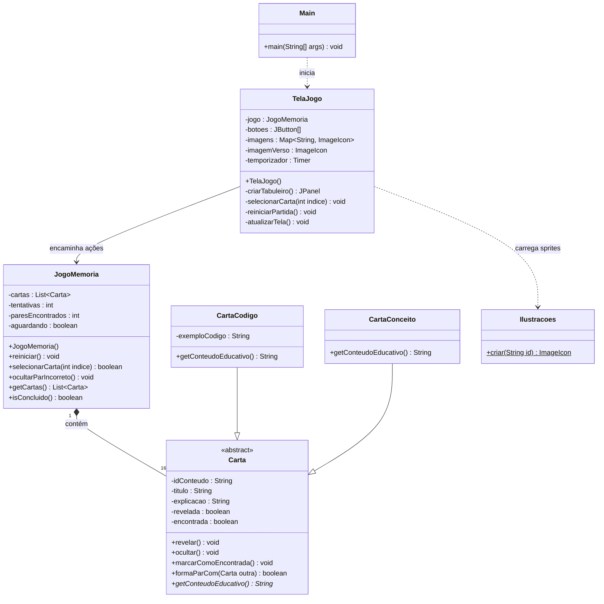

# Code Memory

Jogo da memória educativo desenvolvido em Java Swing. O jogador encontra pares de cartas relacionados a conceitos de programação e orientação a objetos.

## Funcionalidades

- Tabuleiro com 16 cartas embaralhadas, formando oito pares.
- Contador de tentativas e botão para reiniciar a partida.
- Explicações educativas exibidas ao encontrar um par.
- Sprites PNG próprios para cada conceito e para o verso das cartas.

## Requisitos

- JDK 8 ou superior.
- Ambiente com interface gráfica.

## Como executar

Execute os comandos abaixo a partir da pasta raiz do projeto:

```powershell
javac -encoding UTF-8 -d out src\*.java
java -cp out Main
```

Mantenha a pasta `src\resources\sprites` no projeto para que as imagens das cartas sejam carregadas.

## Como jogar

1. Clique em duas cartas para revelar seus conteúdos.
2. Se os conteúdos formarem um par, as cartas permanecem abertas e a explicação aparece na tela.
3. Se não formarem um par, as cartas fecham após um breve intervalo.
4. Encontre os oito pares para concluir a partida. Use **Reiniciar** para começar novamente.

## Estrutura do projeto

- `Main`: inicia a aplicação.
- `TelaJogo`: monta a janela e apresenta o estado da partida.
- `JogoMemoria`: controla as cartas, as tentativas e as regras.
- `Carta`: classe abstrata com os dados e estados comuns.
- `CartaCodigo` e `CartaConceito`: especializam `Carta` e montam o conteúdo educativo.
- `Ilustracoes`: carrega os sprites da pasta `src\resources\sprites`.

## Diagrama de classes



`CartaCodigo` e `CartaConceito` implementam `getConteudoEducativo()` de maneiras diferentes. `JogoMemoria` trabalha com a classe base `Carta`, enquanto `TelaJogo` cuida da apresentação e dos cliques.
