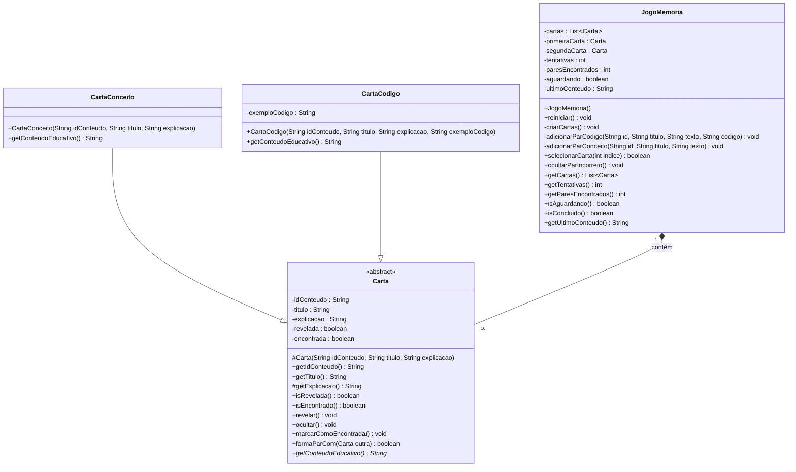
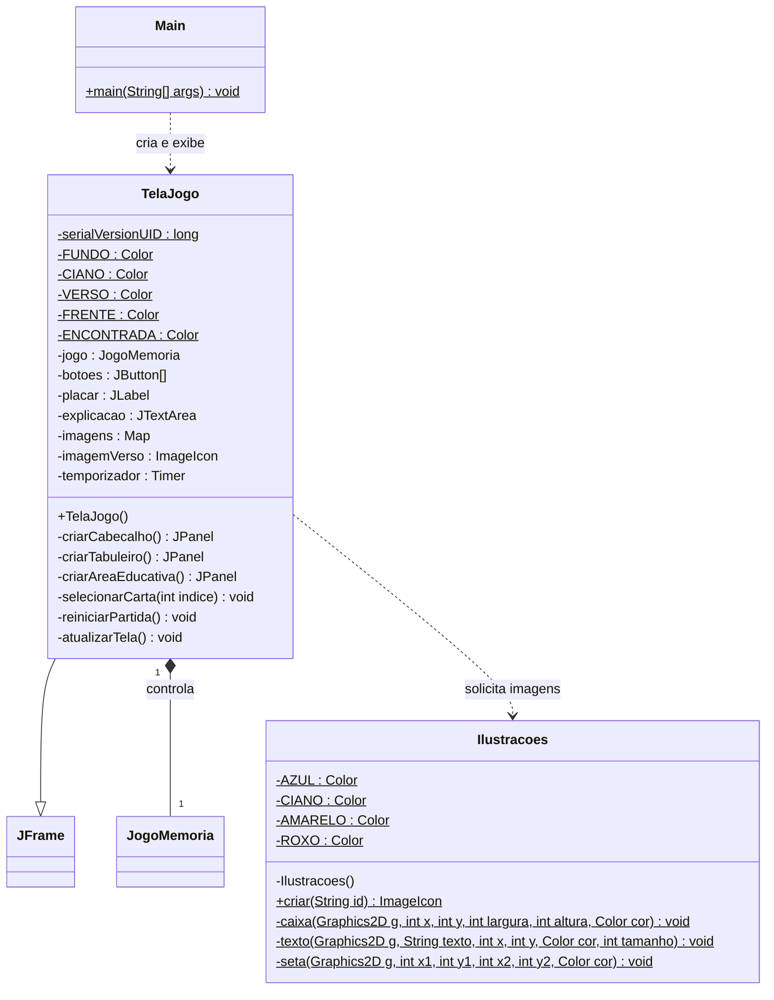
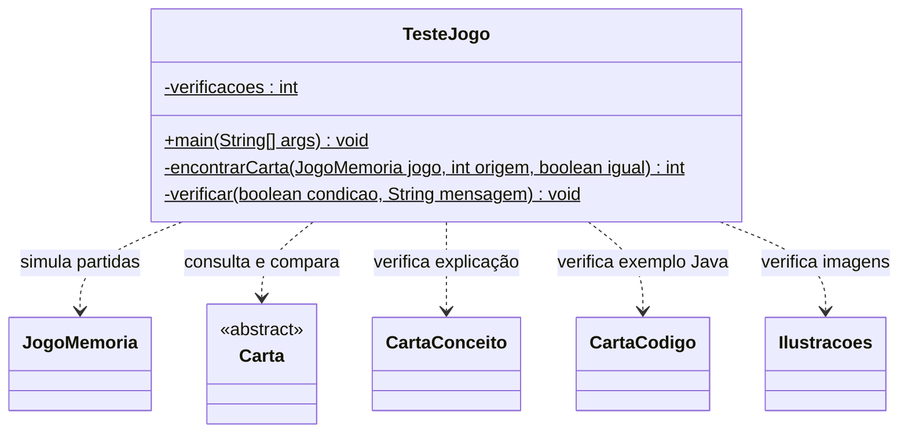

# Code Memory

Jogo da memória educativo em Java Swing, com 16 cartas e 8 pares sobre programação. Projeto pequeno, sem dependências externas, para apresentação em faculdade.

## Estrutura de pastas

```text
jogo2d/
├── src/
│   ├── Main.java
│   ├── Carta.java
│   ├── CartaConceito.java
│   ├── CartaCodigo.java
│   ├── JogoMemoria.java
│   ├── TelaJogo.java
│   └── Ilustracoes.java
├── testes/
│   └── TesteJogo.java
├── README.md
├── EXPLICACAO_DETALHADA.md
├── GITFLOW.md                   (branches, commits e fluxo de integração)
├── PREVIA.png                   (captura de uma partida)
├── .gitignore
└── out/                         (gerada pela compilação)
```

Os arquivos `.java` contêm todo o código, sem partes omitidas. São sete classes na aplicação: as seis sugeridas e `Ilustracoes`, que reúne apenas os desenhos para não misturá-los às regras. O teste é opcional e não faz parte da execução do jogo.

Veja [PREVIA.png](PREVIA.png) para conhecer a aparência de uma partida. A captura é ilustrativa: as posições mudam ao embaralhar. Em janelas menores, use a rolagem da janela e da área educativa.

## Gitflow do projeto

O desenvolvimento segue o fluxo simplificado `feature → develop → main`. A branch `main` guarda a versão estável e `develop` reúne as funcionalidades antes da integração final. As branches `feature/code-memory` e `feature/documentacao` separam a implementação e o material de estudo.

Os commits foram separados por responsabilidade e as integrações usam `git merge --no-ff` para deixar os merges visíveis no histórico. Consulte [GITFLOW.md](GITFLOW.md) para ver as branches, as mensagens dos commits e um roteiro para continuar o projeto.

## Diagramas de classes — padrão Mermaid

Os diagramas seguem o padrão do exemplo da atividade: cada caixa mostra o nome da classe, seus atributos e seus métodos. Foram divididos em três partes para facilitar a leitura. Os nomes, tipos e acessos correspondem aos arquivos Java.

### Cartas e regras do jogo



`CartaConceito` e `CartaCodigo` reaproveitam os dados e comportamentos comuns definidos em `Carta`; por isso eles não são repetidos nas caixas das subclasses. Os atributos privados da base são acessados por seus métodos, respeitando o encapsulamento. Cada partida preparada contém 16 objetos `Carta`, de uma ou outra subclasse.

### Inicialização, janela e ilustrações



`JFrame` pertence ao Swing. `JogoMemoria` aparece novamente como referência à classe detalhada no primeiro diagrama. `Main` cria a janela sem guardá-la em um atributo, então essa relação é uma dependência de criação. `TelaJogo` mantém um objeto `JogoMemoria` como parte de sua estrutura e chama os métodos estáticos de `Ilustracoes`. O atributo `imagens` foi abreviado para `Map` no desenho; seu tipo completo no Java é `Map<String, ImageIcon>`, relacionando o ID à imagem.

### Verificações opcionais



Essa classe é usada somente nas verificações; ela não participa do funcionamento da janela.

### Legenda para explicar ao professor

| Símbolo | Significado | Exemplo no projeto |
| --- | --- | --- |
| `-` | Atributo ou método privado (`private`). | `-saldo` no exemplo da atividade; `-tentativas` neste jogo. |
| `+` | Método público (`public`). | `+revelar() void`. |
| `#` | Membro protegido (`protected`). | `#getExplicacao() String`. |
| `<<abstract>>` | Classe abstrata. | `Carta` não pode ser instanciada diretamente. |
| `*` no final de um método | Método abstrato, mostrado em itálico na renderização. | `getConteudoEducativo()` em `Carta`. |
| `$` no final de um membro | Membro estático (`static`), mostrado sublinhado na renderização. | `main()` e `Ilustracoes.criar()`. |
| `--\|>` | Herança: o triângulo aponta para a classe base. | `CartaCodigo` herda de `Carta`. |
| `*--` | Composição: o losango fica no lado da classe que contém a outra. | `JogoMemoria` contém suas cartas. |
| `..>` | Dependência: uma classe utiliza outra. | `TelaJogo` utiliza `Ilustracoes`. |
| `"1"` e `"16"` | Quantidade de objetos em uma relação. | Uma partida preparada contém 16 cartas. |
| `List~Carta~` | Sintaxe Mermaid para o tipo genérico `List<Carta>`. | Lista de cartas do jogo. |

Os atributos `final` continuam identificados como tal no código comentado. Nos diagramas, o destaque está nos nomes, tipos, acessos e relações, conforme o modelo da atividade. Os construtores não têm tipo de retorno; nos outros métodos, o tipo depois dos parênteses indica o retorno.

Para visualizar as caixas e as setas, abra a pré-visualização Markdown em um editor que suporte Mermaid ou visualize o README no GitHub.

## Tabela das classes

| Classe | Tipo e relação | Responsabilidade | Exemplo de uso |
| --- | --- | --- | --- |
| [Main](src/Main.java) | Classe de entrada. | Inicia a aplicação na thread de eventos do Swing. | Cria e mostra uma `TelaJogo`. |
| [Carta](src/Carta.java) | Classe abstrata, base das duas categorias. | Guarda identidade, título, explicação e estado; define o contrato do conteúdo educativo. | Revela, oculta e compara os IDs das cartas. |
| [CartaConceito](src/CartaConceito.java) | Subclasse de `Carta`. | Representa os quatro pilares com explicação textual. | Mostra a explicação de encapsulamento. |
| [CartaCodigo](src/CartaCodigo.java) | Subclasse de `Carta`. | Representa os quatro temas de programação com explicação e exemplo Java. | Mostra a explicação e um exemplo de arrays. |
| [JogoMemoria](src/JogoMemoria.java) | Classe das regras. | Cria, embaralha e compara as cartas; controla seleções, espera e placar. | Aceita a segunda carta e verifica se houve acerto. |
| [TelaJogo](src/TelaJogo.java) | Subclasse de `JFrame`. | Monta os componentes, encaminha cliques e controla o Timer visual. | Mostra um par encontrado em verde e atualiza a explicação. |
| [Ilustracoes](src/Ilustracoes.java) | Classe utilitária `final`, com métodos estáticos. | Desenha as imagens dos conteúdos e o verso em memória. | `Ilustracoes.criar("arrays")` devolve a imagem de arrays. |
| [TesteJogo](testes/TesteJogo.java) | Classe de verificação opcional. | Confere regras e geração de imagens sem abrir a janela. | Verifica que o terceiro clique é ignorado durante um erro. |

## Tabelas de métodos e construtores

As tabelas relacionam todos os métodos declarados nas classes do projeto. Métodos herdados da biblioteca Swing, como `setVisible()`, não são repetidos aqui. As ações escritas como lambdas ficam explicadas nos comentários do código e no guia detalhado.

**Como ler:** `public` permite chamar de outras classes; `private` restringe à própria classe; `protected` permite acesso pelas subclasses e pelo mesmo pacote. `void` significa que não há valor de retorno. Um construtor cria e prepara o objeto e não declara tipo de retorno. A notação “nenhum” na coluna de parâmetros significa `()`.

### Main

| Método | Acesso | Parâmetros | Retorno | O que faz |
| --- | --- | --- | --- | --- |
| `main` | `public static` | `String[] args` | `void` | Ponto de entrada; agenda a criação e exibição da janela usando `SwingUtilities.invokeLater`. |

`Main` não declara construtor próprio; o compilador fornece o construtor padrão, que não é utilizado pelo jogo.

### Carta

| Método ou construtor | Acesso | Parâmetros | Retorno | O que faz |
| --- | --- | --- | --- | --- |
| `Carta` | `protected` | `String idConteudo`, `String titulo`, `String explicacao` | Não se aplica: construtor. | Inicializa os dados comuns; é chamado pelas subclasses com `super(...)`. |
| `getIdConteudo` | `public` | Nenhum. | `String` | Fornece o ID usado na comparação e na escolha da imagem. |
| `getTitulo` | `public` | Nenhum. | `String` | Fornece o nome exibido na frente da carta. |
| `getExplicacao` | `protected` | Nenhum. | `String` | Disponibiliza a explicação para montar o conteúdo educativo nas subclasses. |
| `isRevelada` | `public` | Nenhum. | `boolean` | Informa se a frente da carta está visível. |
| `isEncontrada` | `public` | Nenhum. | `boolean` | Informa se o par dessa carta já foi acertado. |
| `revelar` | `public` | Nenhum. | `void` | Abre a carta se ela ainda não tiver sido encontrada. |
| `ocultar` | `public` | Nenhum. | `void` | Fecha a carta somente se ela ainda não tiver sido encontrada. |
| `marcarComoEncontrada` | `public` | Nenhum. | `void` | Marca o acerto e garante que a carta permaneça revelada. |
| `formaParCom` | `public` | `Carta outra` | `boolean` | Retorna `true` para outro objeto válido com o mesmo ID de conteúdo. |
| `getConteudoEducativo` | `public abstract` | Nenhum. | `String` | Define o contrato do texto educativo; a implementação fica nas subclasses. |

### CartaConceito

| Método ou construtor | Acesso | Parâmetros | Retorno | O que faz |
| --- | --- | --- | --- | --- |
| `CartaConceito` | `public` | `String idConteudo`, `String titulo`, `String explicacao` | Não se aplica: construtor. | Envia os dados comuns ao construtor de `Carta`. |
| `getConteudoEducativo` | `public`, com `@Override` | Nenhum. | `String` | Implementa o contrato juntando título e explicação. |

Os demais métodos de consulta e controle de estado são herdados de `Carta`, sem duplicação de código.

### CartaCodigo

| Método ou construtor | Acesso | Parâmetros | Retorno | O que faz |
| --- | --- | --- | --- | --- |
| `CartaCodigo` | `public` | `String idConteudo`, `String titulo`, `String explicacao`, `String exemploCodigo` | Não se aplica: construtor. | Inicializa a parte comum com `super(...)` e guarda o exemplo Java. |
| `getConteudoEducativo` | `public`, com `@Override` | Nenhum. | `String` | Implementa o contrato juntando título, explicação e exemplo Java. |

Também herda os métodos de consulta e controle de estado de `Carta`. O que muda em relação a `CartaConceito` é o dado adicional e a implementação do conteúdo educativo.

### JogoMemoria

| Método ou construtor | Acesso | Parâmetros | Retorno | O que faz |
| --- | --- | --- | --- | --- |
| `JogoMemoria` | `public` | Nenhum. | Não se aplica: construtor. | Chama `reiniciar()` para preparar a primeira partida. |
| `reiniciar` | `public` | Nenhum. | `void` | Limpa a partida anterior, zera o placar, cria novas cartas e embaralha. |
| `criarCartas` | `private` | Nenhum. | `void` | Define os oito conteúdos, suas explicações e os quatro exemplos Java. |
| `adicionarParCodigo` | `private` | `String id`, `String titulo`, `String texto`, `String codigo` | `void` | Cria duas instâncias de `CartaCodigo` com o mesmo conteúdo. |
| `adicionarParConceito` | `private` | `String id`, `String titulo`, `String texto` | `void` | Cria duas instâncias de `CartaConceito` com o mesmo conteúdo. |
| `selecionarCarta` | `public` | `int indice` | `boolean` | Valida e revela uma seleção; na segunda, conta a tentativa e compara o par. Retorna se o clique foi aceito. |
| `ocultarParIncorreto` | `public` | Nenhum. | `void` | Oculta as duas cartas do erro, limpa as seleções e libera a próxima jogada. |
| `getCartas` | `public` | Nenhum. | `List<Carta>` | Fornece a lista para consulta, sem permitir inclusão ou remoção por essa referência. |
| `getTentativas` | `public` | Nenhum. | `int` | Fornece o total de duplas válidas selecionadas. |
| `getParesEncontrados` | `public` | Nenhum. | `int` | Fornece o total de pares acertados. |
| `isAguardando` | `public` | Nenhum. | `boolean` | Informa se o jogo está mantendo um erro visível e rejeitando novas seleções. |
| `isConcluido` | `public` | Nenhum. | `boolean` | Informa se os oito pares foram encontrados. |
| `getUltimoConteudo` | `public` | Nenhum. | `String` | Fornece a mensagem inicial ou o conteúdo educativo do último par encontrado. |

### TelaJogo

| Método ou construtor | Acesso | Parâmetros | Retorno | O que faz |
| --- | --- | --- | --- | --- |
| `TelaJogo` | `public` | Nenhum. | Não se aplica: construtor. | Monta a janela, define cores e dimensões e mostra o estado inicial nos componentes. |
| `criarCabecalho` | `private` | Nenhum. | `JPanel` | Monta o título, o placar e o botão Reiniciar. |
| `criarTabuleiro` | `private` | Nenhum. | `JPanel` | Cria a grade 4 × 4, registra as ações dos botões e prepara as imagens. |
| `criarAreaEducativa` | `private` | Nenhum. | `JPanel` | Monta o título da área educativa e o texto com rolagem. |
| `selecionarCarta` | `private` | `int indice` | `void` | Encaminha o clique ao modelo, atualiza os componentes e inicia o Timer ou mostra a vitória. |
| `reiniciarPartida` | `private` | Nenhum. | `void` | Cancela o Timer pendente, reinicia o modelo e atualiza a tela. |
| `atualizarTela` | `private` | Nenhum. | `void` | Atualiza placar, explicação, imagens, títulos, cores e dicas dos botões conforme o estado do jogo. |

**Dois métodos chamados `selecionarCarta`:** o de `TelaJogo` recebe o evento e cuida da apresentação; o de `JogoMemoria` aplica as regras e retorna se a seleção foi aceita. Cada um pertence a uma classe e tem uma responsabilidade diferente.

### Ilustracoes

| Método ou construtor | Acesso | Parâmetros | Retorno | O que faz |
| --- | --- | --- | --- | --- |
| `Ilustracoes` | `private` | Nenhum. | Não se aplica: construtor. | Impede criar instâncias da classe utilitária. |
| `criar` | `public static` | `String id` | `ImageIcon` | Desenha em memória a imagem do conteúdo indicado ou o verso. |
| `caixa` | `private static` | `Graphics2D g`, `int x`, `int y`, `int largura`, `int altura`, `Color cor` | `void` | Preenche e contorna uma caixa arredondada. |
| `texto` | `private static` | `Graphics2D g`, `String texto`, `int x`, `int y`, `Color cor`, `int tamanho` | `void` | Escreve uma legenda com posição, cor e tamanho definidos. |
| `seta` | `private static` | `Graphics2D g`, `int x1`, `int y1`, `int x2`, `int y2`, `Color cor` | `void` | Desenha a linha e os dois lados da ponta de uma seta entre os pontos informados. |

### TesteJogo — opcional

| Método | Acesso | Parâmetros | Retorno | O que faz |
| --- | --- | --- | --- | --- |
| `main` | `public static` | `String[] args` | `void` | Executa as verificações de regras e imagens e mostra o total concluído. |
| `encontrarCarta` | `private static` | `JogoMemoria jogo`, `int origem`, `boolean igual` | `int` | Procura outra carta com ID igual ou diferente do ID da posição de origem, conforme o parâmetro `igual`. |
| `verificar` | `private static` | `boolean condicao`, `String mensagem` | `void` | Conta uma verificação aprovada ou lança `AssertionError` quando a condição falha. |

`TesteJogo` também não declara construtor próprio; o compilador fornece o padrão, que não é usado pelo teste.

## Compilar e executar

É necessário um JDK 8 ou superior, com `java` e `javac` disponíveis no terminal, e um ambiente com interface gráfica. Nenhuma biblioteca precisa ser instalada.

No PowerShell, entre na pasta:

```powershell
cd 'C:\Users\Gusstavo Tucci\OneDrive\onedrive-documentos\Senai\2°Semestre\BackEnd\jogo2d'
```

Compile e execute:

```powershell
javac -encoding UTF-8 -d out src/*.java
java -cp out Main
```

O `javac` cria a pasta `out`. O `java` executa as classes compiladas. A opção `-encoding UTF-8` preserva os acentos dos arquivos-fonte. Não é necessário Maven, Gradle ou acesso à internet.

Para rodar as verificações opcionais, depois de compilar o jogo:

```powershell
javac -encoding UTF-8 -cp out -d out testes/TesteJogo.java
java "-Djava.awt.headless=true" -cp out TesteJogo
```

Essas verificações cobrem as regras e a criação das imagens. Elas não abrem a janela nem substituem os testes manuais dos cliques e do temporizador.

Na preparação desta entrega, a aplicação também foi compilada e passou por uma verificação da janela real: dimensões das cartas, cliques, acerto, espera pelo Timer e cancelamento da espera ao reiniciar. O teste opcional fornecido concluiu 91 verificações.

## Como jogar

1. Clique em duas cartas para revelar os conteúdos.
2. Cada segunda carta válida acrescenta uma tentativa.
3. Se os identificadores forem iguais, as cartas ficam verdes, recebem `OK` no título e permanecem abertas. A explicação aparece abaixo do tabuleiro.
4. Se forem diferentes, ambas ficam abertas por cerca de um segundo. Outros cliques em cartas são ignorados nesse intervalo.
5. Encontre os oito pares para ver a mensagem de vitória com o total de tentativas.
6. Use **Reiniciar** a qualquer momento para zerar o placar e embaralhar novamente.

O embaralhamento é aleatório: uma carta pode cair na mesma posição de antes. Isso não significa que o reinício falhou.

As cartas abordam variáveis, condicionais, laços, arrays, abstração, encapsulamento, herança e polimorfismo. Os quatro primeiros conteúdos apresentam exemplos Java na área educativa. Use a rolagem para ler textos maiores.

## Os quatro pilares neste projeto

| Pilar | Aplicação concreta |
| --- | --- |
| Abstração | `Carta` é abstrata: reúne os dados e estados comuns e exige a implementação de `getConteudoEducativo()`. |
| Encapsulamento | Atributos privados; `revelar()`, `ocultar()` e `marcarComoEncontrada()` controlam os estados. Não há setters de estado. |
| Herança | `CartaConceito` e `CartaCodigo` usam `extends Carta` e reaproveitam seus dados e métodos. |
| Polimorfismo | `JogoMemoria` chama `primeiraCarta.getConteudoEducativo()` por uma referência `Carta`. Cada subclasse fornece sua versão, sem `instanceof`. |

A classe `JogoMemoria` guarda as regras. `TelaJogo` cuida dos componentes Swing e do tempo de espera. `Ilustracoes` desenha as nove imagens, incluindo o verso, em memória com Java2D e `BufferedImage`.

Leia [EXPLICACAO_DETALHADA.md](EXPLICACAO_DETALHADA.md) para estudar os atributos, métodos, condições, laços, desenhos e o fluxo completo de uma jogada.

## Roteiro para apresentar ao professor (3 a 5 minutos)

1. **Objetivo:** “O Code Memory ensina conceitos de programação por meio de oito pares de cartas. Cada acerto apresenta uma explicação e alguns também mostram código Java.”
2. **Demonstração:** revele duas cartas diferentes, mostre a espera de um segundo e o contador. Encontre um par e mostre a explicação e a marcação verde.
3. **Separação:** “`Main` inicia a aplicação, `TelaJogo` apresenta os componentes e `JogoMemoria` controla as regras. As ilustrações são geradas no Java, sem arquivos externos.”
4. **Abstração:** abra `Carta.java` e mostre a classe abstrata e o método abstrato. “Toda carta tem identidade e estado, mas o conteúdo educativo depende da subclasse.”
5. **Encapsulamento:** mostre os atributos `private` e o `if` de `ocultar()`. “Uma carta encontrada não pode ser escondida por esse método.”
6. **Herança e polimorfismo:** mostre `extends Carta` nas duas subclasses e compare seus métodos `getConteudoEducativo()`. Depois mostre a chamada em `JogoMemoria`. “O jogo usa uma referência `Carta`, e o Java escolhe a implementação do objeto.”
7. **Temporizador e reinício:** mostre `new Timer(1000, ...)` e `temporizador.stop()`. Reinicie enquanto duas cartas incorretas estiverem abertas. “O temporizador não trava a tela e é cancelado ao reiniciar.”

## Verificações manuais

| Cenário | Como verificar | Resultado esperado |
| --- | --- | --- |
| Início | Abra o jogo. | 16 versos iguais em 4 × 4; zero tentativas; zero pares. |
| Acerto | Memorize posições e selecione duas cartas do mesmo conteúdo. | As duas permanecem abertas, ficam verdes e mostram `OK`; uma tentativa e um par são acrescentados. |
| Conteúdo educativo | Encontre um par de variáveis, condicionais, laços ou arrays; depois um dos pilares. | Os primeiros mostram explicação e código; os pilares mostram explicação. Sem janela a cada acerto. |
| Erro | Selecione conteúdos diferentes. | Uma tentativa é acrescentada; as cartas ficam visíveis por cerca de um segundo e depois são escondidas. |
| Clique durante espera | Tente abrir uma terceira carta enquanto o erro está visível. | O clique é ignorado; a terceira carta continua fechada e o placar não muda. |
| Clique repetido | Clique duas vezes na mesma carta. | Só o primeiro clique é aceito; não conta uma tentativa nem forma par consigo mesma. |
| Carta encontrada | Depois de um acerto, clique novamente nas cartas do par. | Nenhuma alteração no placar ou na seleção. |
| Mesma subclasse, conteúdos diferentes | Selecione, por exemplo, variáveis e arrays. | É erro, pois os IDs diferem, embora ambas sejam `CartaCodigo`. |
| Vitória | Encontre os oito pares. | Mostra uma mensagem com o total de tentativas e mantém os oito pares abertos. |
| Reinício comum | Clique em Reiniciar após algumas jogadas ou após fechar a mensagem de vitória. | Placar zerado, 16 cartas ocultas, texto inicial restaurado e novo embaralhamento. |
| Reinício durante espera | Erre um par, clique imediatamente em Reiniciar e abra uma carta nova. Aguarde mais de um segundo. | A nova carta permanece aberta; o temporizador antigo foi cancelado e não altera a nova partida. |
| Imagens e legibilidade | Revele todos os conteúdos, redimensione a janela e role a explicação. | Cada conteúdo tem sua ilustração; títulos e exemplos podem ser lidos; os pares usam a mesma imagem. |

O contador mede duplas selecionadas, não o número total de cliques. A verificação da vitória considera os oito pares encontrados, sem limite de tentativas.
